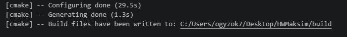
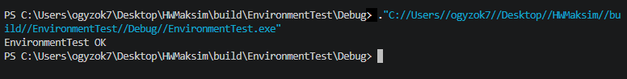
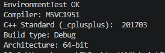
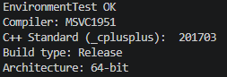

Выполнил Семенюк И. В. 
ИТНиЦТ 1ИВТ2
## Настройка и проверка окружения

### Вывод конфигурации CMake

### Вывод приложения EnvironmentTest

### Поиск и запуск исполняемого файла 

**Расположение исполняемого файла:** *
`build\Debug\EnvironmentTest.exe`

## Вариант 1. Информация о сборке

### Вывод конфигурации Debug

### Вывод конфигурации Release

